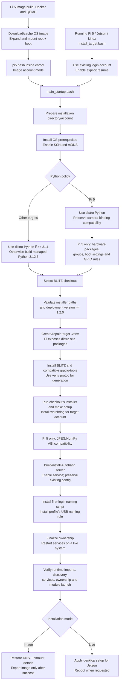
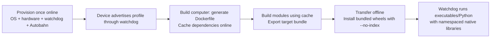

# Target installation dataflow

Image creation and installation into an already booted device share
`installation/modules/main_startup.bash`. Pi camera/GPIO provisioning is specific
to Pi 5. Jetson keeps the NVIDIA base OS, kernel, and drivers; this installer does
not replace JetPack with a generic Linux image.

## Entry points

| Use | Command | Account behavior |
| --- | --- | --- |
| Build a Pi 5 flash image on the build computer | `make build-for pi5` | Creates/configures the requested image account. |
| Install on a running Pi 5 with Raspberry Pi OS Bookworm arm64 | `bash installation/install_target.bash pi5` | Uses the existing login account; does not rename it or change its password. |
| Install on a running Jetson with its NVIDIA OS | `bash installation/install_target.bash jetson` | Uses the existing login account, such as `jetson`. |
| Install on another supported apt/systemd Linux target | `bash installation/install_target.bash linux` | Uses the existing login account; no Pi/Jetson hardware rules. |

Run live installation as the normal login user, without prefixing the command
with `sudo`. Individual system operations use sudo. Jetson's existing
`installation/extra/jetson_nano.bash` remains a compatible entry point. It reboots
after successful validation by default; use `BLITZ_REBOOT=false` to defer that.
For Pi 5, reboot after installation to activate boot overlays and hardware groups.

The original **Jetson Nano** and **Jetson Orin Nano** need different NVIDIA base
images. The JetPack 6.2 image linked in the Jetson instructions is for Orin Nano.
Ubuntu 22.04 ARM64 is the installation simulation for the Orin-generation OS;
this does not certify the original Nano's older JetPack/Ubuntu 18.04 stack.
Ubuntu 18.04 userspace provisioning also passed in Docker, but BLITZ's bundle
builder does not currently support that distro profile. Original Nano deployment
therefore remains unsupported by this audit. Arbitrary Linux
distros and arbitrary Pi images are not covered by these apt-based scripts.

## Shared installation flow



### Source selection and retries

- Fresh installation clones `BLITZ_GIT_URL` at `BLITZ_REF` (default `HEAD`), or
  copies the working tree supplied by `BLITZ_SOURCE_DIR`.
- The installer, setup script, and runtime come from **the same checkout**.
  No standalone installer is downloaded from a different revision.
- An incompatible checkout fails before pip/service setup, with the missing
  path or deployment version in the error. Updating the ImageModifier repository
  alone does not update an already installed BLITZ checkout.
- Live entry points explicitly enable resume. Existing source is preserved;
  source/ref overrides are not reapplied. An existing device name is preserved
  unless `BLITZ_DEFAULT_PI_NAME` explicitly overrides it.
- Direct image installation rejects an existing destination unless resume is
  explicitly enabled; image builds normally begin with a fresh OS working copy.
- Python and Rust toolchains are reused; Autobahn source/build outputs are reused.
  Existing `/etc/autobahn/config.toml` is preserved. Runtime pip setup may still
  access package indexes during this **online provisioning** operation.

### Python packages and compilation

The target needs Python and watchdog's dependencies before it can accept a
deployment. `autobahn-client` currently declares NumPy as a dependency, so NumPy
may still be installed even though application OpenCV is no longer preinstalled.

`installation_common.bash` no longer calls `pip install opencv-python`, sets
pyenv's global interpreter, or replaces `/usr/local/bin/python`. Application
OpenCV belongs in the project's shared requirements, which deployment prepares
inside its per-profile build container and transfers as offline wheels.

Pi 5 always uses distro Python so apt-installed Picamera2/libcamera bindings
remain visible through its environment's `--system-site-packages`. The JPEG
compatibility wheel is installed during online provisioning and validated with
an actual NumPy/JPEG encode/decode check.

Other targets use system Python >= 3.11 or a managed interpreter on older
distros. `BLITZ_PYTHON_MODE=system|managed|auto`, `BLITZ_PYTHON_VERSION`, and
`BLITZ_PYTHON_BINARY` allow an explicit selection. Pi's distro-Python policy
takes precedence over mode selection; a binary override is an expert option
and must be compatible with the distro camera bindings.

Ubuntu's older `protoc` can generate code incompatible with modern Python
protobuf packages. Installation resolves `grpcio-tools` together with the
selected BLITZ package, then creates `.venv/bin/protoc` and prepends that directory
to installation PATH. The system compiler is not replaced. The existing
`make generate` step still generates the protobuf files.

Rust and native compiler packages remain provisioning prerequisites because
Autobahn is currently built from source and the runtime smoke check compiles a
small C++ library. Application native builds still happen on the build computer.

For the Orin's Ubuntu 22.04/Python 3.12 profile, the bundle builder prepares
CPython 3.12.6 from checksum-verified source when the base image lacks Python 3.12.
It lives under `/opt/blitz-python` inside the cached dependency image. Offline
compilation reuses that interpreter and the cached wheels; changing application
source does not trigger Python downloads. This provisioning change increments
the cache schema, so caches from the previous builder require one online refresh.

### USB naming: preserved for both profiles

The USB rule installation moved from `pi5.bash` and the Jetson wrapper into
`installation/modules/install_device_rules.bash`, called before final validation:

| Profile | Source | Destination |
| --- | --- | --- |
| Pi 5 | `installation/system-patch/90-usb-port-names.rules` | `/etc/udev/rules.d/90-usb-port-names.rules` |
| Jetson | `installation/system-patch/90-usb-port-names-jetson.rules` | `/etc/udev/rules.d/90-usb-port-names.rules` |

`sudo install -m 0644` replaces the previous separate remove/copy sequence.
It preserves the rule contents while setting its permissions explicitly.
On running **or degraded** systemd hosts, the helper runs both
`sudo udevadm control --reload-rules` and `sudo udevadm trigger`. During image
compilation there is no running target udev manager; rules are installed and
loaded at boot. The Pi's separate GPIO/camera permission rule also remains.

### Failure and export behavior

- Package installation is noninteractive, so timezone prompts cannot stall an
  unattended build. Live sudo authentication may still prompt normally.
- `iproute2` is installed for watchdog network discovery. Default-route probing
  only reads the kernel routing table; it does not require internet access.
  Watchdog can fall back to an active LAN address when there is no default route.
- Failed shared stages report their line/exit status and stop subsequent stages.
  Jetson reboots only after a successful shared installation.
- Validation checks enabled services; on a live host it also checks that services
  are active and prints status/journal output if one failed. It waits for the
  watchdog HTTP identity endpoint and verifies the installation root/device name.
- Validation launches Python through the installed watchdog and loads a compiled
  C++ `.so`. This checks actual module execution, beyond successful imports.
- Pi validation checks hardware Python imports, JPEG ABI, account groups, rules,
  and boot settings. Electrical GPIO behavior and camera capture require hardware.
- Failed image downloads do not leave a completed cache filename. Corrupt cached
  archives are detected before reuse. Failed chroot setup restores DNS and cleans
  up its mounts/loop device.
- Export requires successful unmount and loop detachment. A busy mount fails
  export instead of producing a potentially inconsistent image. Copying the
  export uses a temporary file before replacing the completed output.

## Relationship to deployment



The target does not need Docker to run application bundles. ImageModifier's
image-editing container and BLITZ's per-profile compilation containers have
different roles. Ordinary deployments do not rerun image provisioning.

## Verification

Run the dedicated script tests from this repository with a Python environment
containing pytest and the current BLITZ dependencies:

```sh
python -m pytest tests -q
```

Tests cover fresh/local/Git source installation, compatible resume, rejection of
obsolete layouts, preserved device identities, stage ordering, Pi-specific
steps, live/degraded/image service behavior, both USB rules and udev operations,
toolchain reuse, failed downloads, and refusal to export busy images.

Passing these tests does not replace physical boot, mDNS reachability from
another computer, Jetson GPU/CUDA operation, or Pi camera/GPIO testing. Those
must be checked on the actual installed board.

### Installation audit results

The script audit exercised:

- 38 dedicated ImageModifier tests passed. BLITZ's final `make test` passed
  197 regression tests. The additional Orin bundle test and six builder tests
  passed after the Python provisioning change.
- The Pi 5 image pipeline on the real ARM64 Bookworm image, including exported
  output, watchdog module/native-library smoke test, hardware binding imports,
  NumPy/JPEG ABI, boot configuration, groups, and enabled services.
- The live Jetson entry point in an ARM64 Ubuntu 22.04 container with an existing
  `jetson` login user. Managed Python, current BLITZ, compatible protobuf generation,
  Autobahn compilation, USB rules, ownership, startup hook, and retry completed.
- Booting that installed Ubuntu userspace under real systemd in Docker. Watchdog,
  Autobahn, SSH, and Avahi were active; the watchdog HTTP identity returned ARM64,
  Ubuntu 22.04, Python 3.12, and the correct installation root. The current live
  validation script also passed against those running services.
- A separate controller container discovered that installed watchdog through
  its actual mDNS advertisement and parsed the advertised profile with BLITZ's
  discovery API. Discovery also passed after the target's default route was
  removed, leaving only its local network route.
- Dedicated tests for both USB rule files, live/degraded reloads, image-mode
  deferral, elevated/idempotent first-login setup, and HTTP identity failures.
- An actual Ubuntu 22.04 ARM64/Python 3.12 dependency image built through the
  generated Dockerfile. A source-only change then compiled offline using the
  same cache. With networking disabled, a fresh runtime environment installed
  the bundled Python wheel and Python loaded the updated C++ shared library.
- Additional Ubuntu 18.04 ARM64 userspace provisioning passed, including managed
  Python, protobuf generation, Autobahn, ownership, and the shared-library smoke
  check. This does not add an Ubuntu 18.04 deployment profile to BLITZ.

Docker does not simulate NVIDIA hardware, a Pi kernel boot on the board, actual
USB port topology, GPIO electrical behavior, or CSI capture. Original Jetson
Nano/JetPack 4 and additional Linux distributions remain separate validation
targets; they are not certified by the Ubuntu 22.04 test.

On an actual NVIDIA device, also inspect watchdog's `capabilities_json` before
assigning CUDA-restricted modules. The current collector uses `nvidia-smi`;
the simulated container correctly advertises no CUDA capability.
