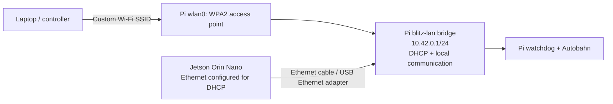

# Raspberry Pi 5 offline Wi-Fi router

Enable `BLITZ_ROUTER_ENABLED=true` to give the Pi a password-protected Wi-Fi
access point and a wired LAN for the Jetson. No internet connection is required.
The option is off by default. It applies only to the Pi 5 installation profile.

Wi-Fi clients and the selected Ethernet ports share one bridge and one IPv4
subnet. NetworkManager provides DHCP and DNS on that bridge. Local messages,
SSH, watchdog HTTP, Autobahn, and mDNS do not need internet access. Application
software still needs to be installed or its dependencies cached beforehand.



This is an offline LAN, not a Wi-Fi repeater. The Pi's built-in Wi-Fi adapter
broadcasts the access point. There is no upstream connection to configure.
NetworkManager's shared mode can also share a separately configured upstream
connection if one is added later; it is not required for local operation.

## Enable on an existing Pi without reflashing

Copy/use the updated ImageModifier checkout on the Pi. Run from its repository
as your normal login user. The dedicated helper changes only router settings;
it does not rerun the BLITZ installer or rebuild application bundles.

```bash
# Replace the example password, SSID, and country as appropriate.
BLITZ_DEVICE=pi5 \
BLITZ_ROUTER_ENABLED=true \
BLITZ_ROUTER_SSID='BLITZ-LAN' \
BLITZ_ROUTER_PASSWORD='replace-this-password' \
BLITZ_ROUTER_COUNTRY=US \
bash installation/modules/installation_pi5_router.bash
sudo reboot
```

Profiles activate on reboot. Existing network connections are not deleted, and
installation does not immediately reload or activate the new profiles. On
reboot the Pi's existing Wi-Fi client connection is replaced by its access
point. Reconnect the controller to the new SSID; the Pi is at `10.42.0.1`.
A phone/laptop may report "no internet"; select the option to stay connected.

Use `ip -br link` to identify the **Pi-side** Ethernet interface attached to the
Jetson. The default is `eth0`; for a USB adapter it might be `eth1` or `enx...`.
Set `BLITZ_ROUTER_LAN_INTERFACES='eth1'` when that is the actual connection.
Multiple LAN ports can be specified separated by spaces. Do not put a future
internet-facing interface in that list. Configure the Jetson's corresponding
Ethernet connection for automatic IPv4/DHCP and remove any incompatible static
address on it. A plain USB cable is not automatically an Ethernet connection;
a USB Ethernet adapter or an already configured USB network interface is needed.

## Include in a newly built image

The same settings pass through Make, Compose, and chroot provisioning:

```bash
BLITZ_ROUTER_ENABLED=true \
BLITZ_ROUTER_SSID='BLITZ-LAN' \
BLITZ_ROUTER_PASSWORD='replace-this-password' \
BLITZ_ROUTER_COUNTRY=US \
make build-for pi5
```

The resulting `outputs/pi5_flash_image.img` starts the access point at boot.
Previously generated images do not gain this option until rebuilt or configured
using the live helper. Router credentials are supplied at runtime, not as Docker
build arguments. Local `.env` files are ignored by Git and excluded from Docker
build context. Do not commit passwords. Generated NetworkManager profiles store
the password using the normal root-only `0600` permissions.

The flag also works with the full live installation command:
`bash installation/install_target.bash pi5`, using the same environment variables.
That command also performs the normal BLITZ installation and validation.

## Settings

| Variable | Default | Meaning |
| --- | --- | --- |
| `BLITZ_ROUTER_ENABLED` | `false` | Opt in to preparing router settings. |
| `BLITZ_ROUTER_SSID` | `BLITZ` | Broadcast name, 1–32 UTF-8 bytes. |
| `BLITZ_ROUTER_PASSWORD` | Required when enabled | WPA2 password, 8–63 printable ASCII characters. |
| `BLITZ_ROUTER_COUNTRY` | `US` | Set this to the country where the Pi is operated. |
| `BLITZ_ROUTER_WIFI_INTERFACE` | `wlan0` | Wi-Fi adapter serving the access point. |
| `BLITZ_ROUTER_LAN_INTERFACES` | `eth0` | Space-separated wired LAN interfaces. |
| `BLITZ_ROUTER_ADDRESS` | `10.42.0.1/24` | Pi LAN address and DHCP subnet; avoid overlapping other connected networks. |

The initial AP uses 2.4 GHz channel 6 and WPA2/AES. Client isolation is disabled
so devices can communicate with one another. The country/unblock service runs
before NetworkManager at boot. Interface names and credentials are validated;
NetworkManager itself validates all generated profiles without requiring a
running daemon in the image chroot. UUIDs and file contents are stable across
reruns; obsolete router Ethernet profiles are retired when the LAN list shrinks.
Unrelated saved network profiles remain intact.

`BLITZ_ROUTER_ENABLED=false` skips provisioning; it does not remove an already
configured router. To stop using router mode, locally disable its autoconnect
profiles in NetworkManager (`nmcli connection show` lists the `blitz-router-*`
profiles), disable `blitz-router-regdomain.service`, and reconnect the Pi's
normal Ethernet/Wi-Fi profile. Do this with local console access if the router
is your only connection to the Pi.

## Check after reboot

```bash
nmcli device status
nmcli connection show --active
ip -4 address show blitz-lan
systemctl status NetworkManager blitz-router-regdomain --no-pager
journalctl -b -u NetworkManager -u blitz-router-regdomain --no-pager
```

On the Jetson, check that its Ethernet adapter has a `10.42.0.x/24` address and
run `ping 10.42.0.1`. On a controller connected to the custom Wi-Fi, run the normal
BLITZ discovery/deployment command. Use current BLITZ with the offline LAN address
fallback so watchdog discovery also works without a default internet route.
The bridge keeps mDNS on one LAN; no multicast reflector or WAN forwarding is
needed to discover local devices.

## Verification and limits

The dedicated tests run with `python -m pytest tests/test_pi5_router*.py -q`.
They cover invalid settings, no changes when disabled, preservation of other
profiles, stable reruns, removal of obsolete owned ports, and password redaction.
A Docker test uses Bookworm's actual NetworkManager 1.42 to validate AP, WPA2,
bridge linkage, and root-only profile permissions. It starts the generated
bridge and DHCP service, removes the container's default route, and verifies
that a simulated Ethernet client receives a lease and can ping the Pi gateway.
Synthetic veth cables are attached directly in that test because NetworkManager
excludes them by default; physical Ethernet activation is still a board check.

Docker cannot test the Pi's actual Wi-Fi radio, regulatory firmware, USB adapter,
or wireless-to-Ethernet traffic. Verify broadcasting and communication on the
Pi before relying on this network for deployments.

References: [Raspberry Pi hotspot documentation](https://www.raspberrypi.com/documentation/computers/configuration.html)
and [NetworkManager 1.42 settings](https://networkmanager.dev/docs/api/1.42.4/nm-settings-nmcli.html),
[offline profile generation](https://networkmanager.dev/docs/api/1.42.4/nmcli.html).
